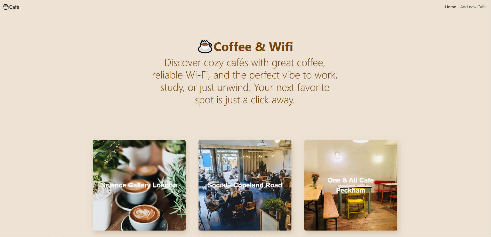
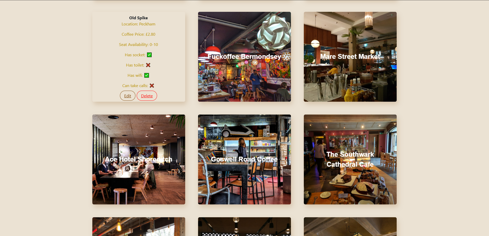
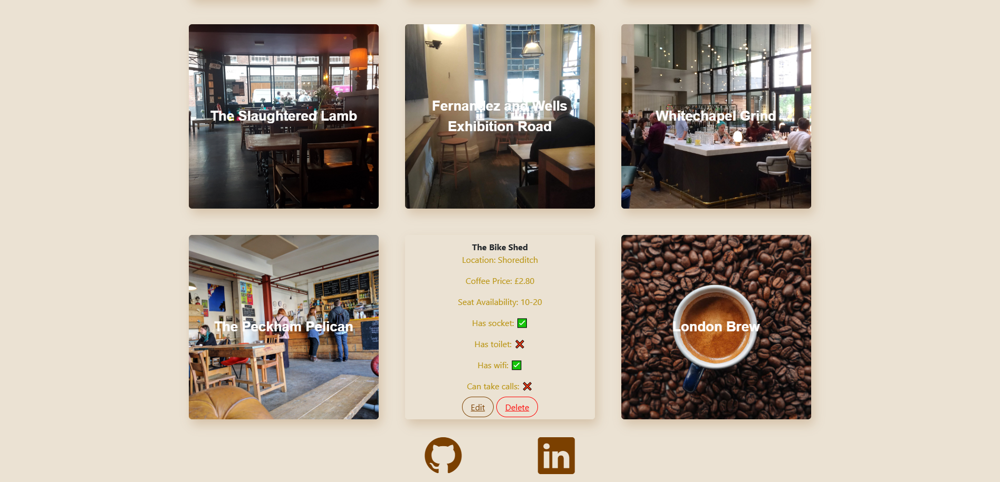
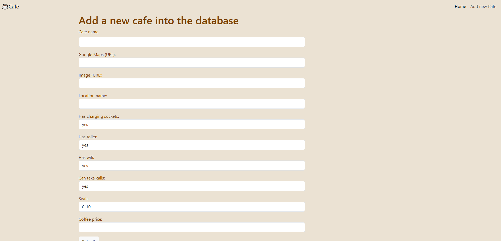
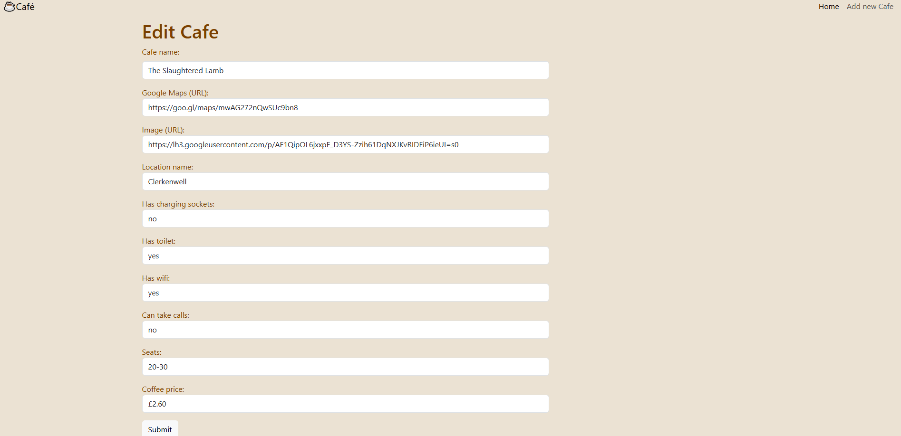

☕ Coffee & Wifi

A Flask web application for discovering cafés that are perfect for working, studying, or relaxing. Browse café details, check available amenities, and manage café listings with full CRUD functionality.

📸 Screenshots
Home Page

Add a Café

Edit a Café

✨ Features:

Browse cafés and view their details.
Add new cafés to the database.
Edit existing café information.
Delete café listings.
Track Wi-Fi, charging sockets, toilets, and call-friendly spaces.
View seating availability, coffee prices, locations, and images.
Validate form inputs and URLs.

🛠️ Built With:

Python — application logic
Flask — web framework
Flask-WTF & WTForms — forms and validation
Flask-SQLAlchemy & SQLAlchemy — database management
SQLite — data storage
Bootstrap 5 — responsive styling
Jinja2 — HTML templating
